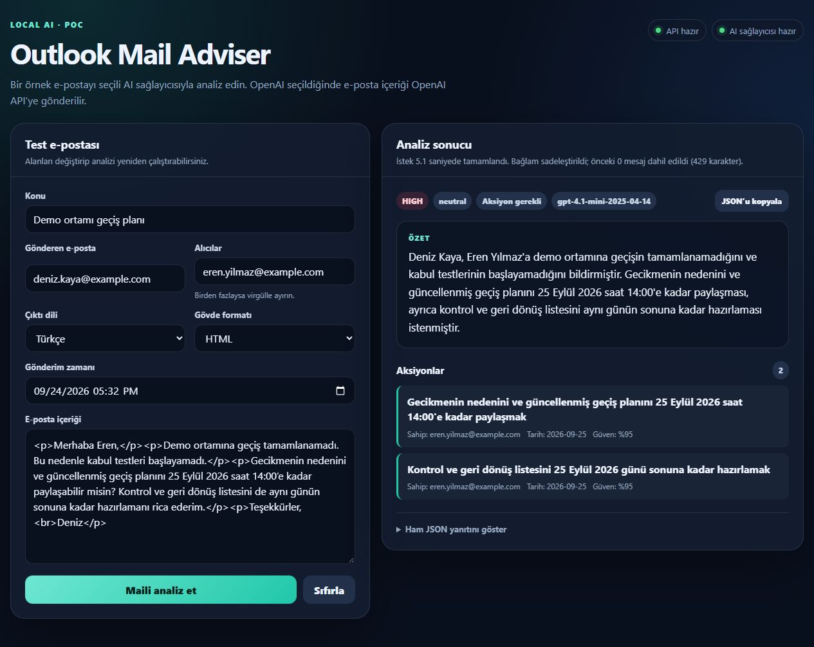

# Outlook Mail Adviser

An AI-powered **local portfolio / proof-of-concept project** developed by Ahmet Almış. It extracts summaries, actions and reply drafts from the email currently open in Outlook.

## Problem and features

Understand “What is expected of me in this email?” without leaving Outlook. The add-in shows a summary, priority, sentiment and dated action items, highlighting actions assigned to you. Specify the main message and tone to generate a draft; you remain responsible for reviewing and sending it. The add-in requests only `ReadItem` permission and does not send email automatically.

The interface supports **English and Turkish**, independently of the output language used for analysis, conversation answers and drafts. On first launch, the interface follows the Outlook display language, falling back to the browser language when unavailable; languages other than Turkish use English. Manual selections are saved locally when storage is available. The output language retains its separate preference and defaults to Turkish.

## Technology and architecture



The screenshot shows the application's browser test page, not the Outlook task pane. The linked detailed guides and existing screenshots may still be in Turkish.

| Layer | Technology / decision |
| --- | --- |
| Outlook interface | Office.js, React, TypeScript, Vite |
| Local API | ASP.NET Core / .NET 8 |
| Model providers | OpenAI (default) or Ollama |
| Architecture | Domain/Application core, ports and provider adapters |
| Checks | xUnit, Vitest, integration and architectural dependency tests |

Keeping provider dependencies in adapters allows switching between OpenAI and Ollama without changing business rules. JSON schemas structure model output; automated tests use provider substitutes and require no API key.
See the [architecture design](POC-DESIGN.md) and [detailed development guide](docs/DEVELOPMENT.md).

## Data flow and privacy

**Outlook → local API → selected model provider → analysis/draft → Outlook.**

With OpenAI, email content and participant information leave your computer. You need your own API key and provider usage may incur charges. With the default local Ollama URL, inference runs on your computer. HTML, signature and history cleanup **does not anonymize data**. Start with the [synthetic demo](docs/DEMO.md). See [SECURITY.md](SECURITY.md) for details.

## Requirements and verified environment

- Windows, PowerShell 7, Git and the .NET 8 SDK specified in `global.json`.
- Node.js 22.12+ (CI uses Node 22); locally verified versions are listed in the [release report](docs/PUBLIC-RELEASE.md).
- An Outlook account/client supporting Office add-ins and custom manifest sideloading. Organization policies may prevent custom add-ins.
- Your own OpenAI API key, or a local Ollama installation with the selected model.

Earlier user-provided screenshots show the flow running in classic Outlook for Windows. See the release report for the revalidation status of this release candidate. Verified compatibility is not claimed for new Outlook, Outlook on the web or macOS.

## Quick start

In PowerShell 7:

```powershell
git clone https://github.com/ahmetalmis/OutlookMailAdviser.git
cd OutlookMailAdviser
dotnet restore OutlookMailAdviser.sln --configfile NuGet.config
dotnet build OutlookMailAdviser.sln --no-restore
dotnet dev-certs https --trust
```

Choose your provider; use only one of the two options:

```powershell
# OpenAI — the key is not written to terminal history.
$env:Ai__Provider = 'OpenAI'
$env:OPENAI_API_KEY = Read-Host 'OpenAI API key' -MaskInput

# Alternative: the Ollama service must be running.
# ollama pull qwen3.5:4b
# $env:Ai__Provider = 'Ollama'

dotnet run --project backend/src/OutlookMailAdviser.Api --launch-profile https --no-build
```

In a separate terminal, from the repository root:

```powershell
cd addin
npm ci
npm run certs
npm run dev
```

During development, the API runs at `https://localhost:7047` and the interface at `https://localhost:3000`. Follow the [Outlook sideloading instructions](addin/README.md) to install `addin/manifest.dev.xml`. Never put an API key in a `VITE_*` variable. Local `.env.local` files are only for non-secret frontend settings such as the API URL.

For a persistent Windows service, automatic startup and updates, see the [Windows service guide](docs/windows-service.md). In daily use, both the interface and API are served on port 7047; use `addin/manifest.xml` or `addin/manifest.localhost.xml`. Vite does not need to run.
See the [configuration guide](PROVIDER-CONFIGURATION.md) to change providers.

## Tests and security checks

```powershell
dotnet test OutlookMailAdviser.sln --no-build --no-restore
dotnet format OutlookMailAdviser.sln --no-restore --verify-no-changes
cd addin
npm test
npm run build
npm run validate
npm run validate:local-host
cd ..
./scripts/Test-Dependencies.ps1
./scripts/Install-Gitleaks.ps1
./scripts/Test-PublicSource.ps1
```

Automated tests do not need a real model or API key. Manifest validation, dependency queries and tool downloads require network access. CI runs the same checks on Windows. Follow the [synthetic scenario](docs/DEMO.md) for a manual demo check.

## Known limitations

- A single-user local POC; it is not designed as an internet-facing service. CORS is not user authentication.
- Model output can be incorrect. Review dates, assignments and drafts.
- Analysis/draft context is limited to 16,000 characters, with a total of 4,000 characters for the two previous messages. Older information may be omitted; the application shows truncation/uncertainty notices.
- Attachments are not analyzed; additional history is not fetched from Outlook. There is no automatic sending.
- A missing OpenAI key is reported during startup validation. Provider connectivity and timeout failures appear as errors rather than results.
- A successful synthetic demo or automated test run does not establish compatibility with every Outlook version.

## License and contributions

[MIT](LICENSE) — Copyright © 2026 Ahmet Almış.
[Third-party licenses and asset sources](THIRD-PARTY-NOTICES.md).
Do not include real email, personal data or API keys when reporting issues.
For security issues, follow the [private reporting instructions](SECURITY.md).

## 1.0.0 — Ask about this conversation

Enter a question about the open email in **Ask about this conversation** in the Outlook add-in.
No initial analysis is required. For example: “What was previously said about the delivery date?”
Only the open email body and history quoted within it are used; other mailbox messages and
attachments are not accessed, and no index or persistent archive is created.

The question flow does not apply the normal analysis history/message character limits. It examines
the entire cleaned body in overlapping chunks sized to the model's context budget. Long conversations
require multiple model calls. You can cancel the operation. The result shows completed/total sections;
timeouts or unverifiable quotes cause the result to be explicitly marked **partial**.

Answers include source quotes verified against the text exactly. Dates and sender headers present in
a quote are preserved; missing information is not invented. When multiple sections contain findings
and the evidence fits the model budget, a combined answer compares contradictions. Otherwise,
section findings appear with a warning that comparison was not possible; no source is silently dropped.
Check the model's interpretation against the quotes.

Select quotes and choose **Use in draft** (up to 20 quotes / 4,000 characters total).
Generate a draft with your current tone and instructions. The server revalidates sources against the
current email body. Moving to another email clears sources and results.

API: `POST /api/v1/mail/questions`, body: `{ "message": <current message>, "question": "...", "preferredLanguage": "tr" }`.
Response: `answer`, `sources` (`id`, `quote`, UTF-16 `startOffset` within the cleaned body),
`completedChunks`, `totalChunks`, `isPartial`, `warnings`. Questions are limited to 1,000 characters;
HTTP 400 is returned if the configured model context leaves no room for the question. The optional
`sourceQuotes` array in `POST /api/v1/mail/draft` carries selected quotes. Existing requests without sources remain compatible.


## Local action tracking

After analyzing an email, choose **Track action** next to an action. Review or edit the email subject,
action text, owner and optional due date, then choose **Save**. A missing owner is allowed and appears
as **Owner not specified**. Only the saved note fields are retained; the email body is not stored.

The **My actions** button at the top of the panel shows the active count and opens saved actions from
all emails. Search by subject/action, filter by owner, or edit a note. **Mark completed** moves a note
out of the active list; use the **Completed** view and **Reopen** to bring it back. Returning to the
email preserves the current analysis and draft fields. There are no automatic notifications or messages;
use the list to give reminders yourself during meetings.

Notes are stored on this computer, independently of browser storage and the AI provider. The Windows
service uses `C:\ProgramData\OutlookMailAdviser\data\action-notes.json`; development uses
`.artifacts/action-data/action-notes.json` in the repository. These files contain saved email subjects
and action details: keep them private. Service updates preserve the data folder and back up the store
while the service is stopped. To back up manually, stop the service before copying the file.

This is a single-user local list, separate from Outlook Notes, Outlook Tasks and Microsoft To Do.
It does not synchronize across devices. Both English and Turkish interfaces are supported; saved
note content keeps the language you entered. See the [Windows service guide](docs/windows-service.md) for update details.
